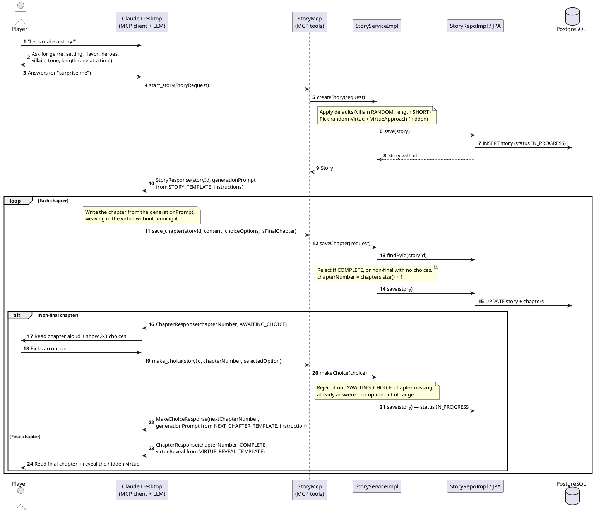
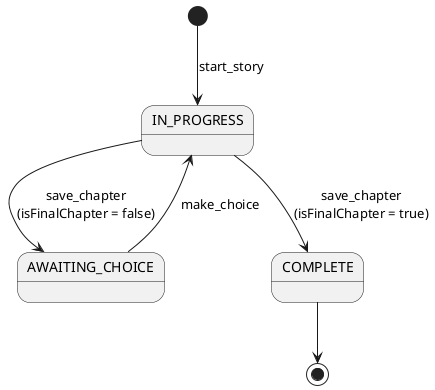

# MCP Server Flow (PlantUML)

The same flow as [MCP server flow](mcp-server-flow.md), drawn with PlantUML.

The server never calls an LLM itself. It owns the story **state** and the **prompts**; Claude Desktop (the MCP client) does the writing. Each tool response hands Claude a generation prompt plus an instruction saying which tool to call next.

## Request flow

Rejections (`StoryException`) are returned as a normal response with `rejected: true` and a `message`, not as protocol errors, so Claude can explain the problem to the player and recover.

## Story lifecycle

