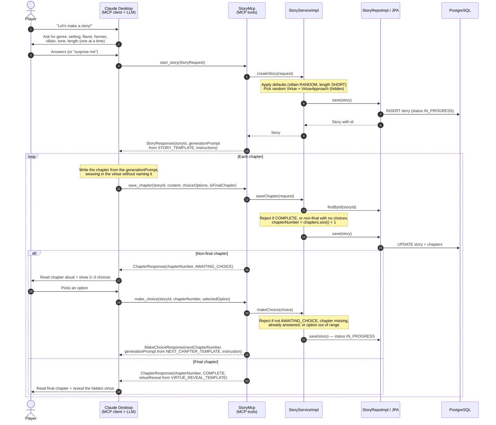
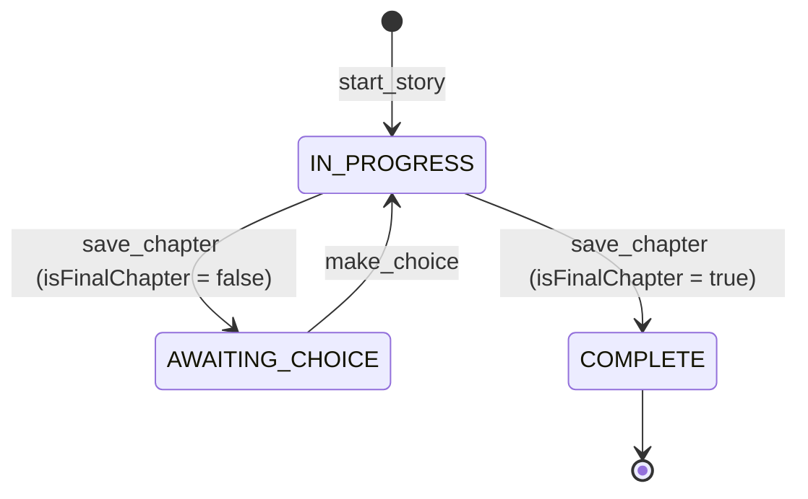

# MCP Server Flow

How a story moves between the player, Claude Desktop and the Story Teller MCP server.

The server never calls an LLM itself. It owns the story **state** and the **prompts**; Claude (the MCP client)
does the writing. Each tool response hands Claude a generation prompt plus an instruction saying which tool to call
next, so the conversation is steered by the server.

## Components

| Layer          | Class                               | Role                                                                                  |
|----------------|-------------------------------------|---------------------------------------------------------------------------------------|
| Presentation   | `StoryMcp`                          | Exposes the MCP tools (`@McpTool`) over streamable HTTP on port `8282`                |
| Application    | `StoryServiceImpl`                  | Picks the hidden virtue, validates transitions, updates `StoryStatus`                 |
| Infrastructure | `AppConstants`                      | Prompt templates: `STORY_TEMPLATE`, `NEXT_CHAPTER_TEMPLATE`, `VIRTUE_REVEAL_TEMPLATE` |
| Persistence    | `StoryRepoImpl` → `StoryEntityRepo` | Maps `Story` ↔ `StoryEntity` and stores it via JPA (PostgreSQL)                       |

## Request flow

Rejections (`StoryException`) are returned as a normal response with `rejected: true` and a `message`, not as protocol
errors, so Claude can explain the problem to the player and recover.

## Story lifecycle

## Tools at a glance

| Tool           | Called when                          | Returns                                                          |
|----------------|--------------------------------------|------------------------------------------------------------------|
| `findStories`  | Player wants to see existing stories | Story titles (or `Story[id]`)                                    |
| `start_story`  | All parameters gathered              | `storyId`, chapter 1 prompt, next-step instructions              |
| `save_chapter` | Claude has written a chapter         | `chapterNumber`, new status, `virtueReveal` on the final chapter |
| `make_choice`  | Player picked an option              | `nextChapterNumber`, next chapter prompt, next-step instruction  |
